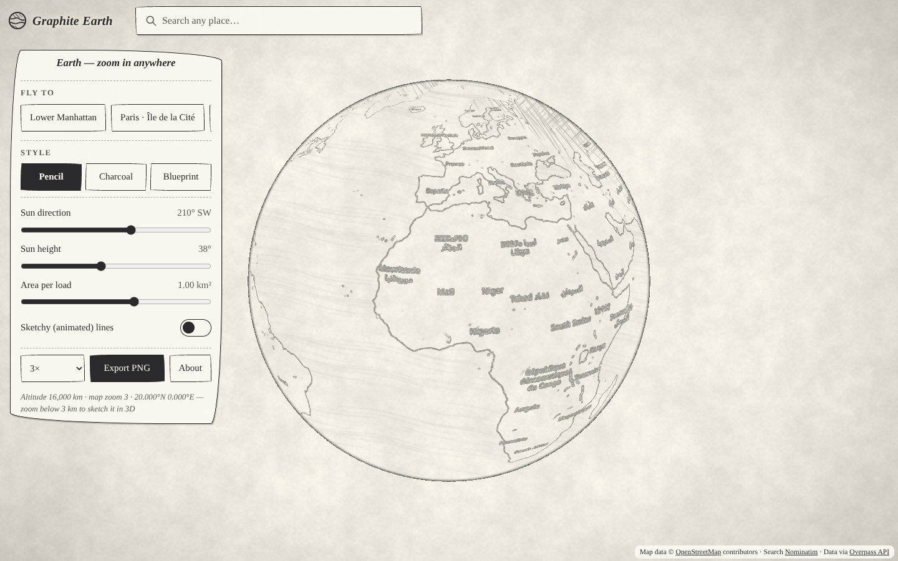
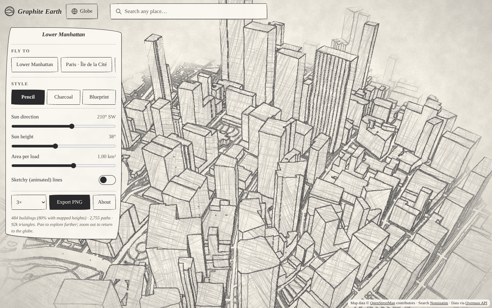
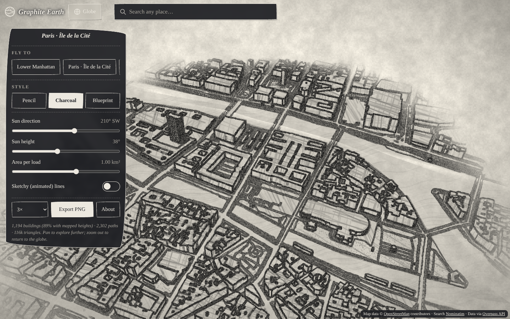
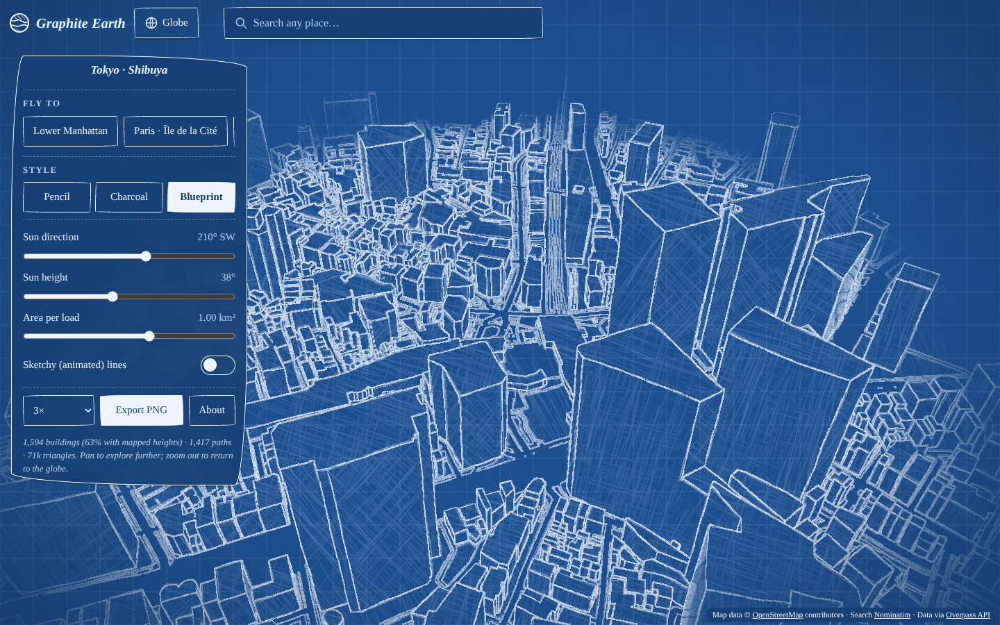
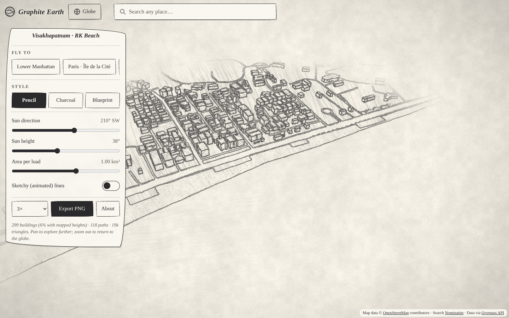
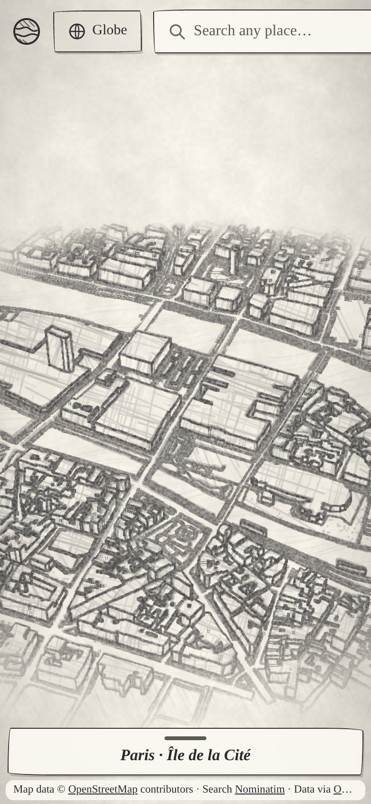
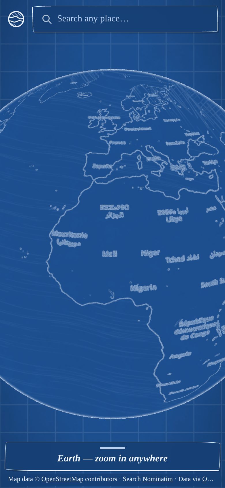

# Graphite Earth

[](https://github.com/PavanIT1217/graphite-earth/actions/workflows/ci.yml)
[](https://github.com/PavanIT1217/graphite-earth/actions/workflows/deploy-pages.yml)

**The whole world as a hand-made pencil sketch.** Spin a drawn globe, zoom in anywhere, and the real
map sharpens into ink; go below 3 km and the streets beneath you rise up as a 3D drawing of the actual
buildings. Pencil, charcoal and blueprint styles. Live: **https://pavanit1217.github.io/graphite-earth/**

Vite + TypeScript + three.js. All data comes from OpenStreetMap — no API keys. Ships as a website,
an installable PWA, and iOS / Android apps (Capacitor).

| Globe | Lower Manhattan (pencil) |
| --- | --- |
|  |  |
| **Paris · Île de la Cité (charcoal)** | **Tokyo · Shibuya (blueprint)** |
|  |  |
| **Visakhapatnam · RK Beach** | **Phone** |
|  |   |

## Features

- **Globe → street, anywhere.** OSM raster tiles stream onto a 3D Earth by zoom level (quadtree with a
  permanent low-zoom base, fall-back levels while loading, fade-in) and are drawn by a sketch shader.
  Below 3 km altitude the area under the camera is fetched from Overpass and built in 3D; panning the
  city re-centres on fresh data; zooming out returns to the globe.
- **3D city from OSM**: building footprints (incl. multipolygons with courtyards) extruded with
  `height` / `building:height` / `building:levels` (× 3.2 m) / per-type fallbacks; roads and rails as
  ribbons sized by highway type, rivers, water, coastline-derived sea, parks, beaches.
- **Sketch rendering**: ink outlines with wobble, tonal hatching driven by the sun (cross-hatching only
  in shadow), paper grain, vignette, optional animated "sketchy" lines; **pencil / charcoal / blueprint**.
- **Sun direction & height sliders**, orbit / pan / zoom (mouse and touch).
- **Search any place** (Nominatim) and fly-to presets: Lower Manhattan, Paris Île de la Cité,
  Tokyo Shibuya, Visakhapatnam RK Beach.
- **Export** the current view as a 2×–4× PNG (with OSM attribution stamped in).
- **Phone-friendly**: merged geometry, building LOD tiles, capped pixel ratio, smaller shadow maps,
  render-on-demand (no frames drawn while idle).
- **Good citizenship**: 1 req/s to Nominatim, serialised + spaced Overpass queries with mirror fallback
  and `Retry-After`, debounced search, ≤ 1.5 km² per load, IndexedDB response cache (14 days),
  identifying User-Agent in the native apps (Referer on the web), visible attribution.
- **SEO & PWA**: meta / Open Graph / Twitter cards, JSON-LD, sitemap, robots, canonical, manifest,
  service worker, privacy page.

## Getting started

```bash
npm install
npm run dev            # http://localhost:5173
npm test               # Vitest: projection, tiles, OSM parsing, heights, mesh builder, cache, rate limiter
npm run build          # type-check + production build into dist/
```

Mobile: `npm run android` / `npm run ios` (build, sync, open the IDE). Store publishing is automated by
GitHub Actions — see [docs/MOBILE_RELEASE.md](docs/MOBILE_RELEASE.md) and [docs/store-listing.md](docs/store-listing.md).

Other scripts: `npm run screenshots` (live data; `FIXTURE=1` uses a synthetic city when Overpass is down),
`npm run icons`.

### Configuration

| Env var | Default | Purpose |
| --- | --- | --- |
| `VITE_TILE_URL` | `https://tile.openstreetmap.org/{z}/{x}/{y}.png` | Globe tile source. For heavy traffic or store apps at scale, point this at your own tile server or a provider, per the [OSM tile policy](https://operations.osmfoundation.org/policies/tiles/). The sketch shader recognises OSM-Carto colours for water and parks. |

Overpass mirrors and rate limits live in `src/core/config.ts`.

## Project structure

```
src/
  core/      config (endpoints, limits, presets)
  data/      nominatim.ts, overpass.ts, osm.ts (parser), heights.ts, cache.ts (IndexedDB), rateLimiter.ts, http.ts
  geo/       projection.ts (lat/lng → local metres), polygon.ts (rings, clipping, simplify), tiles.ts (slippy maths)
  mesh/      geometryWriter.ts, buildings.ts (extrusion), flat.ts (areas, ribbons, ground), cityBuilder.ts (merging, LOD tiles)
  globe/     globeView.ts (tile quadtree, fly-to), tileCache.ts (LRU + download queue), globeShader.ts
  render/    pipeline.ts (G-buffer + composite), stage.ts (camera, sun, controls), shaders/sketch.ts,
             textures/ (procedural hatching + paper), styles.ts, exporter.ts
  ui/        search combobox, progress/toasts
  platform/  native detection, PNG save/share
tests/       Vitest unit tests
scripts/     screenshots, icons, synthetic city fixture
android/ ios/  Capacitor native projects
```

## How the shaders work

### City: three passes

1. **Scene pass** → colour target. Every surface uses a white Lambert material, so **R = lighting**
   (ambient + sun, including the shadow map). The material colour is `(1, class, 1)` and the vertex colour
   `(1, 1, fade)`, so **G / R = surface class** (ground 0, water 0.2, park 0.4, sand 0.6, road 0.8,
   building 1.0) and **B / R = edge-of-map fade**. Ambient + sun ≤ 1 keeps these ratios exact.
2. **Normal pass** → `MeshNormalMaterial` via `scene.overrideMaterial`, with a depth texture attached.
3. **Composite** (`src/render/shaders/sketch.ts`), a full-screen triangle:
   - **(a) Ink edges** — a 3×3 **Sobel** on *linearised depth* (relative to distance, so far and near
     edges look alike), on *view-space normals* (creases), and on the *surface class* (outlines flat roads,
     water and parks). The sample position is pushed by low-frequency value noise → lines **wobble**; a
     second, differently-offset pass adds occasional doubled strokes; per-pixel noise makes lines grainy.
     Lines thin out with distance.
   - **(b) Hatching** — four tileable stroke layers are generated procedurally into one RGBA texture
     (sparse diagonal, denser parallel, cross diagonal, dense near-horizontal). Darkness = 1 − lighting goes
     through a tone curve (sunlit faces stay nearly blank) and is split into four bands that enable R, G, B,
     A in turn — so only real shadow reaches **cross-hatching**. The hatch rotates with the surface normal
     so each façade reads as its own plane. Water gets wavy horizontal strokes, parks stipple, roads stay paper.
   - **(c) Paper** — multi-octave value-noise grain with fibres, multiplied in, plus a soft **vignette**;
     blueprint adds a drafting grid. Beyond the loaded area everything fades into blank paper.
   - **(d) Sketchy mode** re-seeds the wobble noise ~8×/s, so lines "boil" like hand-drawn animation.

### Globe: one pass per tile

`src/globe/globeShader.ts` draws each OSM tile directly: Sobel on the tile's luminance with a radius of one
*screen* pixel (`fwidth`) for thin ink outlines; dark pixels (labels, symbols) inked directly so they read
like hand lettering; OSM-Carto water blue → ripples, greens → stipple; land tone and the night side
(N·L from the sun) → the same tonal hatching; a Fresnel term draws the globe's pencil rim.

### Performance

Merged geometry (one draw call per surface class, buildings in 300 m tiles), `THREE.LOD` with simplified
footprints beyond 1.1 km, pixel ratio capped at 1.5 on phones (2 on desktop), 1024² shadow maps on phones,
tiles limited to 4 concurrent downloads with an LRU of 260 textures, and rendering only when the camera,
sun, style or data changes.

## Data, attribution & usage policies

Map data © [OpenStreetMap contributors](https://www.openstreetmap.org/copyright) (ODbL). Search by
[Nominatim](https://operations.osmfoundation.org/policies/nominatim/), data via the
[Overpass API](https://wiki.openstreetmap.org/wiki/Overpass_API#Public_Overpass_API_instances), tiles from
the [OSM tile servers](https://operations.osmfoundation.org/policies/tiles/). Attribution is always visible
and stamped onto exports.

## Deployment

Pushing to `main` runs CI (typecheck, tests, build, Android debug build) and deploys to GitHub Pages
(Settings → Pages → Source: **GitHub Actions**).

## License

Code: [MIT](LICENSE). Map data: ODbL © OpenStreetMap contributors.
